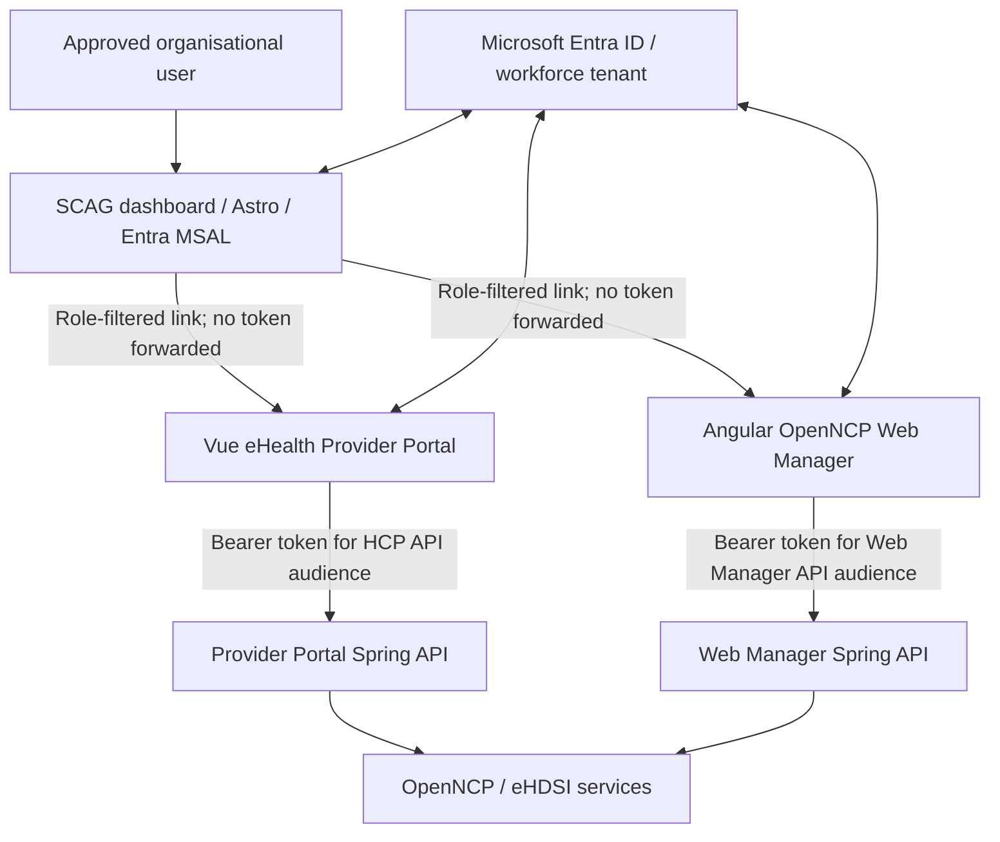

# Cross-application Microsoft Entra architecture

Status: implementation architecture record (19 October 2026). This document describes the three linked repositories; it is not evidence of production security accreditation or deployment.

## Components and ownership

| Application | Repository | Framework | Function | Entra role values |
| --- | --- | --- | --- | --- |
| Shared Care Access Gateway (SCAG/NCP-Connect) | [scag-dashboard](https://github.com/ddeveloper72/scag-dashboard) | Astro, MSAL Browser | Organisation-managed entry point and role-filtered launchpad | `HealthcareProvider`, `Pharmacist`, `Admin`, `Reports` (dashboard app roles for launch visibility) |
| eHealth Provider Portal | [ehealth-portal](https://github.com/ddeveloper72/ehealth-portal) | Vue, MSAL Browser; Java/Spring backend | Patient search, clinical and medication workflows | `HealthcareProvider`, `Pharmacist` |
| OpenNCP Web Manager | [ehealth](https://github.com/ddeveloper72/ehealth) | Angular, MSAL Browser; Java/Spring backend | Administration, SMP, audit and reports | `Admin`, `Reports` |

The phrase **SystemAdministrator** describes an administrative persona; the implemented Web Manager API role value is **`Admin`**, not `SystemAdministrator`. SCAG launch roles and downstream API roles are distinct assignments even where their string values match.

## Architecture and trust boundaries

SCAG uses its own SPA app registration, reads its own ID-token `roles` claim, and filters launch buttons on the client. This is navigation assistance **not** permission to invoke clinical or administrative APIs. A user can enter a downstream URL directly: that application's resource-server authorization is the enforced boundary.

Each downstream SPA uses MSAL authorization-code flow with PKCE and requests an access token for its **own** API's delegated `access_as_user` scope. Backend validation must enforce token signature, issuer/tenant, API audience, scope and API app role. Tokens issued to SCAG or another API must not be reused or forwarded across applications.

The provider API recognises `HealthcareProvider` and `Pharmacist`. Pharmacists are restricted to patient search and medication workflows; provider-only clinical and FHIR endpoints remain restricted to `HealthcareProvider`. The Web Manager API uses `Admin` for administration and reporting and `Reports` for read-only reporting. These are separate security policies, not a shared global permission.

## Sign-in and logout

1. The user signs into SCAG using Microsoft Entra ID. The dashboard displays links based on SCAG-specific app-role assignments.
2. Selecting a clinical or Web Manager link opens the corresponding application. That SPA establishes its own MSAL account/session and API-specific token, taking advantage of the existing Entra browser session where supported.
3. The downstream backend independently validates the bearer token and its functional role before executing a request.
4. Provider Portal local logout clears its local MSAL artifacts and returns to SCAG without global Entra logout. SCAG's sign-out performs the Entra session logout. Web Manager logout behavior is application-specific and should be validated separately.

Locally documented endpoints: SCAG `http://localhost:4321/dashboard/`; Provider Portal `http://localhost:8093/#/login?autologin=1` (API `8092`); Web Manager frontend `http://localhost:8098` (backend `8097`). These are development values, not production addresses.

## Boundary to eHDSI

Entra authenticates and authorizes the *portal caller*. It does not replace OpenNCP gateway trust, signing certificates, SAML/XSPA assertions, eHDSI identity/context mapping, or clinical audit obligations. Do not forward Entra bearer tokens through gateway/SOAP/SAML/NCP messages. The NCP connector continues to generate the appropriate eHDSI assertions under approved identity mapping and national governance.

## Verification and limitations

- SCAG role-filtered buttons are verified from `src/scripts/dashboard.js` and ID-token role reading from `src/scripts/msal.js`.
- Provider Portal MSAL, router roles, and API protection are documented in its `src/auth/index.js`, `src/router/index.js`, and `docs/MICROSOFT-ENTRA-SETUP.md`.
- Web Manager implementation, including tests for `Admin` and `Reports`, is documented in `docs/WEB-MANAGER-ENTRA-SETUP.md` in the `ehealth` repository.
- These are repository and local-test findings; organisational tenant assignments, production deployment, conditional-access enforcement, independent security review, and upstream Code Europa file-by-file comparison require separate evidence.

## Reference documents

- [SCAG README](https://github.com/ddeveloper72/scag-dashboard/blob/main/README.md)
- [Provider Portal Entra setup](https://github.com/ddeveloper72/ehealth-portal/blob/feature/entra-authentication/docs/MICROSOFT-ENTRA-SETUP.md)
- [Provider Portal SCAG troubleshooting](https://github.com/ddeveloper72/ehealth-portal/blob/feature/entra-authentication/docs/ENTRA-OPENNCP-TROUBLESHOOTING.md)
- [Web Manager Entra setup and changed-file inventory](https://github.com/ddeveloper72/ehealth/blob/feature/entra-access/docs/WEB-MANAGER-ENTRA-SETUP.md)
